<!-- ======================================================== -->
<!-- 🌊 OCEAN WAVE HERO BANNER & IDENTITY                     -->
<!-- ======================================================== -->

  

  

   

  <!-- Metric Badges -->
  
  
  

    

  <!-- 🌟 PRIMARY SKILLS ORDERED MATRIX 🌟 -->
  
<b>⚡ PRIMARY SKILLS MATRIX</b>

  
  
  
  
  
  

    

## Hi there 👋

<!--
**shashig123/shashig123** is a ✨ _special_ ✨ repository because its `README.md` (this file) appears on your GitHub profile.

Here are some ideas to get you started:

- 🔭 I’m currently working on ...
- 🌱 I’m currently learning ...
- 👯 I’m looking to collaborate on ...
- 🤔 I’m looking for help with ...
- 💬 Ask me about ...
- 📫 How to reach me: ...
- 😄 Pronouns: ...
- ⚡ Fun fact: ...
-->

### 🌊 Quick Executive Brief

- 🔭 **Role & Experience**: **Senior DevOps Engineer** with **6.3+ years** of hands-on experience in architecting, automating, and scaling enterprise cloud platforms.
- ⭐ **Primary Skills**: **Azure Cloud** ➔ **Terraform (Template & Admin)** ➔ **Kubernetes (K8s)** ➔ **Docker** ➔ **DevSecOps**.
- 📦 **Helm 3 Packaging**: Authoring reusable, parameter-driven **Helm 3 charts**, values management, dependency trees, and automated packaging pipelines.
- 🛡️ **DevSecOps Core**: Embedding Shift-Left security, automated vulnerability scanning (SAST/DAST/Container), secret management, and compliance-as-code across all CI/CD pipelines.
- 🏗️ **IaC Mastery**: Terraform Enterprise Administrator & Modular Template Architect, orchestrating immutable, self-healing cloud ecosystems.
- 🔄 **GitOps & Pipelines**: Production-grade Azure DevOps pipelines, GitHub Actions, and GitOps-driven delivery with zero downtime.
- 📜 **Scripting Power**: Heavy automation with PowerShell, Bash, and Python.
- 💬 **Ask me about**: Azure Landing Zones, Terraform state locking, K8s cluster hardening, Docker container optimization, Helm 3 packaging, and GitOps workflows.
- 📫 **How to reach me**: Open to high-impact Senior DevOps, DevSecOps, Platform Engineering, and Cloud Architecture roles.
- ⚡ **Engineering Philosophy**: *"If a system requires manual intervention more than once, it belongs in code; if it runs in production, it must be impenetrable."*

---

<!-- ======================================================== -->
<!-- 🌊 CORE STACK & EXPERTISE MATRIX                         -->
<!-- ======================================================== -->
## 🌊 Technical Arsenal & Ecosystem

### ☁️ Cloud & Governance (Primary Skill #1)

  
  
  
  
  

  
<b>🔍 Click to view Production Topics in Azure Cloud & Governance</b>

   

- 🌐 **Enterprise Landing Zones**: Hub-and-Spoke network topology, Azure Virtual WAN, ExpressRoute/VPN gateways, Private Endpoints & Private DNS.
- 📜 **Azure Policy as Code**: Defining and assigning initiative definitions, automated remediation tasks, and CIS benchmark compliance.
- 🔐 **Identity & Access Management (IAM)**: Role-Based Access Control (RBAC), Custom Roles, Privileged Identity Management (PIM), and Managed Identities.
- 💰 **FinOps & Cost Governance**: Automated resource rightsizing, reservation planning, budget alerts, and tagging policy enforcement.

 

### 🏗️ Infrastructure as Code (IaC) - Terraform Admin & Templates (Primary Skill #2)

  
  
  

  
<b>🔍 Click to view Production Topics in Terraform (Admin & Templates)</b>

   

- 📦 **Enterprise Reusable Modules**: Authoring production-ready modular templates with strict DRY principles, standard inputs/outputs, and documentation.
- 🔒 **State File Administration**: Remote backend in Azure Blob Storage with state locking (lease), encryption-at-rest, and state access RBAC.
- 🏢 **Multi-Environment Orchestration**: Structuring workspaces, directory isolation, dynamic `.tfvars`, and environment parity (`dev`, `stage`, `prod`).
- 🔄 **State Operations & Disaster Recovery**: Safe resource refactoring (`terraform state mv`), import workflows, state repair, and zero-drift verification.
- 🛡️ **Automated IaC Security Gates**: Automated `terraform validate`, `tflint`, security scans with `tfsec` & `Checkov` in pull request triggers.

 

### 🚢 Containers, Kubernetes & Helm 3 Packaging (Primary Skills #3, #4 & Packaging)

  
  
  
  
  

  
<b>🔍 Click to view Production Topics in Kubernetes, Docker & Helm 3 Packaging</b>

   

- 📦 **Helm 3 Packaging**: Modular chart authoring, parameterizing `values.yaml` for multiple stages, chart dependency management, semantic versioning, and private registries (ACR).
- ☸️ **AKS Cluster Hardening**: Managed identities, Azure CNI networking, system vs user node pool segregation, and cluster autoscaling.
- 🛡️ **Pod Reliability & Security**: Resource limits & requests, Taints & Tolerations, Pod Disruption Budgets (PDB), and Network Policies.
- 🚦 **Traffic & Ingress Routing**: Ingress Controller (Nginx/Traefik), TLS termination, automatic certificate issuance via cert-manager.
- 🐳 **Docker Container Optimization**: High-performance multi-stage Docker builds, Alpine/distroless minimal base images, non-root user execution, and layer caching.

 

### 🛡️ DevSecOps & Security Automation (Primary Skill #5)

  
  
  
  
  
  

  
<b>🔍 Click to view Production Topics in DevSecOps & Security</b>

   

- 🔍 **Shift-Left SAST/DAST**: SonarQube automated code quality analysis and security quality gates blocking vulnerable PRs.
- 🛡️ **Container Image Auditing**: Automated Trivy vulnerability scans in CI pipelines gating Docker images before ACR push.
- 🔑 **Secrets Management**: Zero hardcoded credentials, automated secret rotation, Azure Key Vault integration with Managed Identities & HashiCorp Vault.
- ⚖️ **Policy as Code (PaC)**: Gatekeeper / OPA rules enforcing container non-root execution, mandatory labels, and allowed registries.

 

### 🔄 CI/CD & GitOps Delivery

  
  
  
  
  

  
<b>🔍 Click to view Production Topics in CI/CD & GitOps Delivery</b>

   

- 🔄 **GitOps Delivery (ArgoCD)**: Declarative Git-driven synchronization, automated drift detection, self-healing sync policies, and multi-cluster deployment.
- ⚡ **Azure DevOps Pipelines**: Modular multi-stage YAML pipelines, deployment jobs, environment gates, branch policies, and reusable pipeline templates.
- 🚀 **GitHub Actions**: Custom composite actions, workflow triggers, matrix builds, artifact caching, and Azure OIDC authentication (secretless).
- 🔁 **Zero-Downtime Release Strategies**: Blue/Green releases, Rolling updates, Canary traffic routing, and instant rollback triggers.

 

### 📜 Scripting & Automation

  
  
  

  
<b>🔍 Click to view Production Topics in Scripting & Systems Automation</b>

   

- ⚡ **PowerShell Enterprise Automation**: Custom PowerShell modules, Az CLI wrappers, automated resource provisioning, user access audits, and pipeline tasks.
- 🐚 **BASH Scripting**: Linux server bootstrap scripts, container entrypoints, text processing (`awk`, `sed`, `jq`), and automated cron maintenance.
- 🐍 **Python Automation**: Cloud API integrations, custom metric collectors, webhook handlers, and automated report generators.

 

### 📊 Observability & Monitoring

  
  
  
  

  
<b>🔍 Click to view Production Topics in Prometheus, Grafana & Monitoring</b>

   

- 📈 **Kube-Prometheus-Stack**: Deployment & configuration of Prometheus Operator, Node Exporter, and kube-state-metrics on AKS.
- ⚡ **PromQL Production Queries**: Custom alerts for CPU throttling, memory leaks, crashlooping pods, and network drop rates.
- 🚨 **Alertmanager Rules**: Production routing trees, alert grouping, inhibition rules, and integrations with Slack/Teams.
- 📊 **Custom Grafana Dashboards**: Real-time visualization of the **4 Golden Signals** (Latency, Traffic, Errors, Saturation), pod resource usage, and cluster capacity.
- 🔍 **Azure Monitor & Log Analytics**: KQL (Kusto Query Language) queries for log parsing, container insights, and audit alerts.

---

<!-- ======================================================== -->
<!-- 🌊 ARCHITECTURAL PILLARS & VALUE PROPOSITION             -->
<!-- ======================================================== -->
## 🌊 What Sets Me Apart (6.3+ Years Deep Dive)

<table>
  <tr>
    <td width="50%" valign="top">
      <h3>☁️ Azure Cloud & Platform Architecture</h3>
      <ul>
        <li><b>Enterprise Landing Zones:</b> Architected hub-and-spoke virtual networks, ExpressRoute/VPN, private DNS zones, and private endpoints.</li>
        <li><b>Cloud Governance & RBAC:</b> Designed Azure Policies, management group hierarchies, budget alerts, and role-based access control.</li>
        <li><b>Cost & Resource Optimization:</b> Implemented auto-scaling, reserved instances, and telemetry-driven rightsizing across Azure workloads.</li>
      </ul>
    </td>
    <td width="50%" valign="top">
      <h3>🏗️ Terraform Template & Administration</h3>
      <ul>
        <li><b>Modular Architecture:</b> Built production-ready reusable Terraform templates adhering to DRY principles across enterprise business units.</li>
        <li><b>State Administration:</b> Managed remote state backends with strict RBAC, automated state locking, and zero-drift verification.</li>
        <li><b>Policy Enforcement:</b> Enforced compliance via automated linting (TFLint, tfsec, Checkov) and policy-as-code guardrails.</li>
      </ul>
    </td>
  </tr>
  <tr>
    <td width="50%" valign="top">
      <h3>☸️ Kubernetes, Docker & Helm 3 Packaging</h3>
      <ul>
        <li><b>Cluster Orchestration:</b> Provisioned and hardened Azure Kubernetes Service (AKS) clusters with multi-zone high availability.</li>
        <li><b>Docker Containerization:</b> Authored optimized multi-stage Docker builds, image hardening, minimal distroless footprints, and CVE reduction.</li>
        <li><b>Helm 3 Packaging:</b> Engineered modular Helm 3 charts, templated manifest management, chart repositories, and automated versioning.</li>
      </ul>
    </td>
    <td width="50%" valign="top">
      <h3>🛡️ DevSecOps, GitOps & Automation</h3>
      <ul>
        <li><b>Shift-Left Gates:</b> Integrated automated SAST, DAST, and container vulnerability scanning (Trivy/Aqua) directly inside PR triggers.</li>
        <li><b>Secrets & Compliance:</b> Zero-hardcoded credentials, integrated with HashiCorp Vault & Azure Key Vault, audited against CIS benchmarks.</li>
        <li><b>GitOps & Scripting:</b> End-to-end GitOps delivery with ArgoCD and mission-critical PowerShell and Bash automation suites.</li>
      </ul>
    </td>
  </tr>
</table>

---

<!-- ======================================================== -->
<!-- 🌊 END-TO-END DEVSECOPS DELIVERY LIFECYCLE               -->
<!-- ======================================================== -->
## 🌊 End-to-End DevSecOps Pipeline Flow

```mermaid
flowchart LR
    A[💻 Git Commit] --> B[🔍 Pre-Commit / Linting]
    B --> C[🛡️ SAST & Secrets Audit]
    C --> D[🏗️ Terraform Plan & Validate]
    D --> E[📦 Docker Build & Trivy Scan]
    E --> F[📦 Helm 3 Packaging]
    F --> G[🚀 GitOps Trigger ArgoCD]
    G --> H[☸️ Hardened K8s AKS]
    H --> I[📊 Prometheus & Grafana Monitor]

    style A fill:#03045e,stroke:#00b4d8,stroke-width:2px,color:#fff
    style B fill:#0077b6,stroke:#00b4d8,stroke-width:2px,color:#fff
    style C fill:#d32f2f,stroke:#ff8a80,stroke-width:2px,color:#fff
    style D fill:#7b42bc,stroke:#b388ff,stroke-width:2px,color:#fff
    style E fill:#2496ed,stroke:#90e0ef,stroke-width:2px,color:#fff
    style F fill:#0f1687,stroke:#82b1ff,stroke-width:2px,color:#fff
    style G fill:#f05032,stroke:#ffab91,stroke-width:2px,color:#fff
    style H fill:#326ce5,stroke:#82b1ff,stroke-width:2px,color:#fff
    style I fill:#f46800,stroke:#ffd180,stroke-width:2px,color:#fff
```

---

<!-- ======================================================== -->
<!-- 🌊 GITHUB ANALYTICS (OCEAN WATER THEME)                  -->
<!-- ======================================================== -->
## 🌊 GitHub Engineering Activity

  <table border="0">
    <tr>
      <td align="center">
        
      </td>
      <td align="center">
        
      </td>
    </tr>
  </table>

   

  

 

---

<!-- ======================================================== -->
<!-- 🌊 CONNECT WITH ME & COLLABORATE                         -->
<!-- ======================================================== -->

  <h2>🌊 Let's Build Resilient Cloud Systems Together</h2>
  
<b>Seeking a seasoned Senior DevOps Engineer / Cloud Platform Specialist who can turn complexity into automated elegance?</b>

  
  &nbsp;
  
  &nbsp;
  

    
  
<i>"Security isn't an afterthought—it's the foundation of modern infrastructure."</i>

  <!-- Water Wave Footer -->
  

